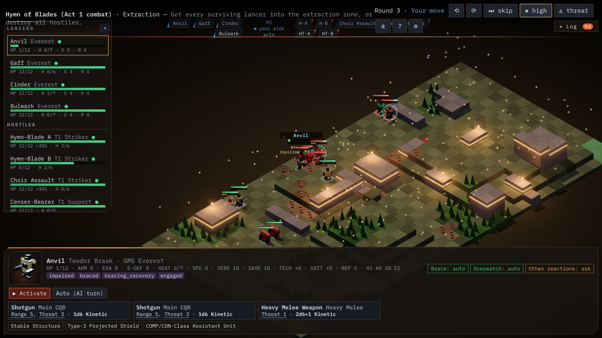

# Dreams of Vermillion

A personal, non-commercial **LANCER** tactics roguelike that runs in the browser. Build a lance of up to four pilots in the in-game builder or in COMP/CON, then fight through three acts of increasingly dangerous enemy teams on a 2.5D isometric grid. The rules engine follows the LANCER core book.



## Features

- **A campaign in three acts**, each with a branching map of combat, elite, supply, rest and boss nodes, plus between-battle events. Damage, Repairs and spent gear carry over between fights.
- **Fixed act levels.** Act 1 is fought at License Level 0, act 2 at LL5 and act 3 at LL10, and the squad must be levelled up properly between acts.
- **Pilots your way.** Use the in-game builder (checked live against the build rules), import COMP/CON exports, or pick one of the pre-built squads.
- **Full mech combat.** Every LANCER player frame, CORE, weapon, system, mod, talent rank and core bonus is run by the engine, with cover, line of sight on a height map, reactions, statuses, structure and overheating.
- **Original enemies.** The enemies are built from an original NPC ruleset with 20 teams. If you own the official NPC content pack, you can also import it locally.
- **Saves as you play,** with full undo of your last action and replay files for bug reports.

## Play

**Online:** once GitHub Pages is enabled, the game is at <https://zlt298.github.io/Dreams-of-Vermillion-/>. Nothing to install: progress saves in your browser.

**Locally:** you need Node.js 22 and a browser with WebGL.

```bash
git clone --recurse-submodules https://github.com/zlt298/Dreams-of-Vermillion-.git
cd Dreams-of-Vermillion-/game
npm install
npm run dev            # then open http://localhost:5173
```

The COMP/CON pregens are pre-loaded, so you can start a run straight away. To bring in your own pilots, build them at [compcon.app](https://compcon.app), choose **Export → Save as file (.json)**, and drop the file on the Hangar.

## Documentation

- [Playing](docs/PLAYING.md): building pilots, act levels, pre-built squads, the campaign, battle controls, saving and undo.
- [Enemies](docs/ENEMIES.md): the original NPC ruleset, the enemy team files, generating teams with Claude, and importing official NPCs.
- [Engine and development](docs/ENGINE.md): the rules engine, coverage, known deviations, tests, replays, code layout and deployment.
- [Roadmap](docs/ROADMAP.md), [design notes](docs/DESIGN.md) and the [enemy ruleset](docs/enemy-ruleset.md).

## Credits and attribution

*Dreams of Vermillion is not an official Lancer product; it is a third party work, and is not affiliated with Massif Press. Dreams of Vermillion is published via the Lancer Third Party License. Lancer is copyright Massif Press.*

- **LANCER** is created by Tom Parkinson-Morgan and Miguel Lopez and published by [Massif Press](https://massifpress.com).
- **Game data** comes from [`@massif/lancer-data`](https://github.com/massif-press/lancer-data) by Massif Press, used under the GPL-3.0.
- **COMP/CON** is Massif Press's official LANCER companion app. This project reads its pilot export format and includes its pregens, and pins [COMP/CON](https://github.com/massif-press/compcon) (GPL-3.0) as the `vendor/compcon` submodule.
- **No paid content is bundled.** The core book and NPC packs aren't included. Official NPCs are only loaded from a pack you own, in your own browser, and are never uploaded.
- The enemy teams, the enemy ruleset, the story and the game code are original to this project.

## License

GPL-3.0-or-later; see [`LICENSE`](LICENSE).
